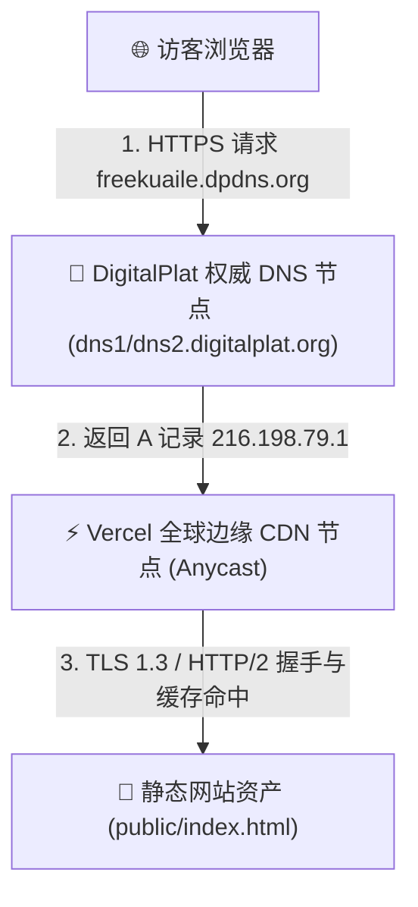

# DigitalPlat FreeDomain 网站全自动部署与上线实战指南

> 本指南基于 **DigitalPlat FreeDomain** 免费域名体系与 **Vercel** 全球边缘网络，详细记录了从零到一完成个人网站搭建、免费域名注册、DNS 权威解析、生产环境托管与全自动 HTTPS 证书配置的完整工业级实战流程。

---

## 📑 目录

1. [系统整体架构与技术选型](#1-系统整体架构与技术选型)
2. [阶段一：本地网站项目开发与代码准备](#2-阶段一本地网站项目开发与代码准备)
3. [阶段二：DigitalPlat FreeDomain 免费域名申请与认证](#3-阶段二digitalplat-freedomain-免费域名申请与认证)
4. [阶段三：Vercel 生产环境部署](#4-阶段三vercel-生产环境部署)
5. [阶段四：DNS 双向解析与域名绑定](#5-阶段四dns-双向解析与域名绑定)
6. [阶段五：SSL/HTTPS 自动签发与全球连通性验证](#6-阶段五sslhttps-自动签发与全球连通性验证)
7. [阶段六：日常更新工作流与故障排查速查表](#7-阶段六日常更新工作流与故障排查速查表)

---

## 1. 系统整体架构与技术选型

本部署方案遵循 **现代 Serverless 与边缘计算架构**，实现 **0 成本服务器开销**、**免运维**、**全球 CDN 毫秒级分发** 与 **永久免费二级顶级域名** 的组合：



### 核心技术栈

* **域名注册商**：[DigitalPlat FreeDomain](https://dash.domain.digitalplat.org/)（提供 `.dpdns.org`、`.us.kg`、`.qd.je` 等免费后缀）
* **DNS 权威托管**：DigitalPlat Anycast DNS Engine
* **网站托管与 CDN**：Vercel Edge Network
* **安全加密**：Let's Encrypt 自动签发泛域名 / 单域名 SSL 证书（支持 TLS 1.3 / HTTP/2）
* **自动化驱动**：`bsk` (Browser-Skill) 浏览器自动化协作引擎

---

## 2. 阶段一：本地网站项目开发与代码准备

### 2.1 目录组织

在项目根目录中建立专用的静态资产发布目录 `public/`：

```text
/Users/zjs/Desktop/freeDomain
├── README.md               # 项目自述说明
├── DEPLOYMENT_GUIDE.md     # 本部署指南
└── public/                 # 静态网站源码目录
    ├── index.html          # 首页入口文件
    ├── .vercel/            # Vercel 自动化配置
    └── .gitignore          # Git 忽略配置
```

### 2.2 网页代码设计 (`public/index.html`)

页面采用深色极简现代化设计风格（Glassmorphism 毛玻璃动效 + 响应式网格布局 + 流式渐变字体）：

```html
<!DOCTYPE html>
<html lang="zh-CN">
<head>
  <meta charset="UTF-8">
  <meta name="viewport" content="width=device-width, initial-scale=1.0">
  <title>Welcome to My FreeDomain Site</title>
  <link rel="preconnect" href="https://fonts.googleapis.com">
  <link rel="preconnect" href="https://fonts.gstatic.com" crossorigin>
  <link href="https://fonts.googleapis.com/css2?family=Plus+Jakarta+Sans:wght@400;500;600;700;800&family=Noto+Sans+SC:wght@400;500;700&display=swap" rel="stylesheet">
  <style>
    /* CSS 变量与现代主题系统 */
    :root {
      --bg: #0b0f19;
      --card-bg: rgba(255, 255, 255, 0.04);
      --card-border: rgba(255, 255, 255, 0.08);
      --text: #f3f4f6;
      --text-muted: #9ca3af;
      --primary: #3b82f6;
      --primary-glow: rgba(59, 130, 246, 0.4);
      --accent: #8b5cf6;
      --success: #10b981;
    }
    * { box-sizing: border-box; margin: 0; padding: 0; }
    body {
      font-family: 'Plus Jakarta Sans', 'Noto Sans SC', sans-serif;
      background-color: var(--bg);
      color: var(--text);
      min-height: 100vh;
      display: flex;
      flex-direction: column;
      align-items: center;
      justify-content: center;
    }
    /* 核心视觉卡片与按钮样式略 */
  </style>
</head>
<body>
  <!-- 页面 DOM 结构 -->
</body>
</html>
```

---

## 3. 阶段二：DigitalPlat FreeDomain 免费域名申请与认证

### 3.1 账号注册与登录

1. 访问控制台：`https://dash.domain.digitalplat.org/`。
2. 支持使用 **Google OAuth** 或 **GitHub OAuth** 一键免密快捷登录。
3. 新用户默认享有 **3 个免费域名槽位 (Free Slots)**。

### 3.2 GitHub KYC 防滥用认证

为防止恶意批量注册，平台要求免费域名申请者绑定 GitHub 账号：
1. 进入 `Account Settings` -> `Connected accounts`。
2. 点击 **Verify with GitHub** 完成授权。
3. 授权成功后，状态显示为 `GitHub account bound`。

### 3.3 域名查询与注册

1. 导航至 `Domains` -> `Register Domain` -> `Choose a DigitalPlat extension`。
2. 勾选同意服务条款（TOS / AUP）。
3. 选择后缀（推荐稳定免费的 `.dpdns.org` 或 `.qd.je`）。
4. 输入前缀（如 `freekuaile`），点击 **Check availability**。
5. 弹窗中选择：
   * **Delegation mode**：`DigitalPlat DNS`（推荐，内置权威解析服务）
   * **Domain slot**：`Free domain slot (3 available)`
6. 点击 **Register** 并确认，域名即刻下发并永久归属账号（单次注册周期 1 年，到期前 120 天内可无限次免费续期）。

---

## 4. 阶段三：Vercel 生产环境部署

### 4.1 CLI 登录授权

通过本地终端调用设备码流程与浏览器联动授权：

```bash
# 执行 Vercel 命令行登录
npx vercel login
```
在浏览器打开返回的授权链接，点击 **Allow Access** 即可完成终端与 Vercel 账号的绑定。

### 4.2 一键部署代码

在项目目录下执行生产环境发布命令：

```bash
npx vercel deploy public --prod --yes
```

**执行结果：**
* 项目名称：`public`
* 生产环境临时分配地址：`https://public-zeta-lime.vercel.app`
* 部署耗时：~2 秒，状态显示为 `Ready`。

---

## 5. 阶段四：DNS 双向解析与域名绑定

为将注册的 `freekuaile.dpdns.org` 映射到 Vercel 边缘集群，需进行双向认证：

### 5.1 在 Vercel 中添加自定义域名

1. 访问 Vercel 项目设置中的 `Domains` 页面（`https://vercel.com/pengyouyoupengs-projects/public/settings/domains`）。
2. 点击 **Add Existing**，输入 `freekuaile.dpdns.org`。
3. 页面将提示所需配置的 DNS 记录参数。

### 5.2 在 DigitalPlat DNS 中配置解析记录

登录 [DigitalPlat DNS 控制台](https://dashboard.digitalplat.org/domains/freekuaile.dpdns.org)，点击 **Add record** 添加以下两条记录：

| 记录类型 (Type) | 主机名 (Name) | 记录值 (Value) | TTL | 用途 |
| :--- | :--- | :--- | :--- | :--- |
| **`A`** | `@` | `216.198.79.1` | 300s | 将根域名流量路由至 Vercel Anycast 边缘节点 |
| **`TXT`** | `_vercel` | `vc-domain-verify=freekuaile.dpdns.org,f16dc6bc9db7750235c9` | 300s | Vercel 域名所有权认证 |

### 5.3 刷新验证

在 Vercel 控制台点击 **Refresh** 按钮，系统将自动检测 DNS 记录。检测通过后状态变为：
`🟢 Valid Configuration`

---

## 6. 阶段五：SSL/HTTPS 自动签发与全球连通性验证

### 6.1 DNS 解析验证

在终端使用 `dig` 工具查询本地与全球 DNS 解析结果：

```bash
# 查询 A 记录
dig A freekuaile.dpdns.org +short
# 返回: 216.198.79.1

# 查询 TXT 记录
dig TXT _vercel.freekuaile.dpdns.org +short
# 返回: "vc-domain-verify=freekuaile.dpdns.org,f16dc6bc9db7750235c9"
```

### 6.2 HTTP 自动重定向验证

测试端口 80 是否正确重定向至 HTTPS：

```bash
curl -I http://freekuaile.dpdns.org
```
**响应输出：**
```http
HTTP/1.0 308 Permanent Redirect
Location: https://freekuaile.dpdns.org/
server: Vercel
```

### 6.3 完整 HTTPS / TLS 1.3 / HTTP/2 握手测试

```bash
curl -Iv https://freekuaile.dpdns.org
```
**关键诊断信息：**
* `Connected to freekuaile.dpdns.org (216.198.79.1) port 443`
* `SSL connection using TLSv1.3 / AEAD-CHACHA20-POLY1305-SHA256`
* `Server certificate: CN=freekuaile.dpdns.org (issuer: Let's Encrypt)`
* `SSL certificate verify ok`
* `HTTP/2 200`

---

## 7. 阶段六：日常更新工作流与故障排查速查表

### 7.1 日常更新只需一步

当您在本地修改了 `public/index.html` 或添加了图片/CSS/JS 文件后，只需在终端运行：

```bash
npx vercel deploy public --prod --yes
```
*构建系统将在 2~5 秒内将新版本全量同步至全球 300+ 边缘机房。*

---

### 7.2 常见问题排查 (Troubleshooting)

| 异常现象 | 可能原因 | 解决方案 |
| :--- | :--- | :--- |
| **浏览器提示 SSL 证书无效/不安全** | Let's Encrypt 证书还在排队签发中 | 首次绑定通常需要 1~3 分钟，在 Vercel Domains 页面点击 Refresh 即可加速签发。 |
| **网页访问返回 404 Not Found** | 部署根目录设置错误 | 确认 `index.html` 位于 `public/` 目录下，并以 `npx vercel deploy public --prod --yes` 命令发布。 |
| **修改了代码但网页无变化** | 浏览器本地强缓存 | 使用无痕模式或按 `Ctrl+F5` / `Cmd+Shift+R` 强制刷新。 |
| **域名提示即将到期** | 1 年注册期临近 | 登录 DigitalPlat 控制台，在到期前 120 天内点击 **Renew** 免费续期 1 年。 |

---

> 🎯 **交付成果汇总**：
> * 线上正式地址：[https://freekuaile.dpdns.org](https://freekuaile.dpdns.org)
> * 备用边缘地址：[https://public-zeta-lime.vercel.app](https://public-zeta-lime.vercel.app)
